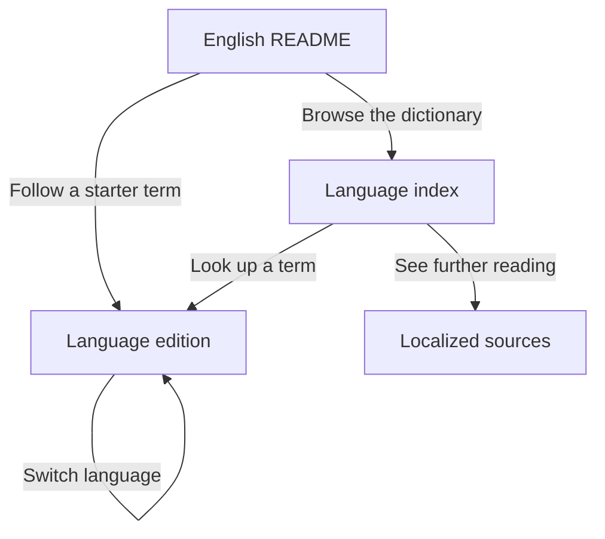

# Bilingual AI dictionary

```yaml spec-ir
id: dictionary-lookup
kind: flow
nodes:
  - id: home
    type: page
    label: English README
    meta: {audience: Readers with no programming background, runtime: GitHub Markdown, default_language: en}
  - id: index
    type: page
    label: Language index
    meta:
      paths: [dictionary/en.md, dictionary/es.md]
      ordering: Alphabetical by display term in each language
      aliases: Include acronyms and common terms seen in tools; the Spanish index shows English names when useful
      coverage: List every entry in both indexes
  - id: entry
    type: page
    label: Language edition
    meta:
      identity: One folder with a stable ASCII slug for each concept under dictionary/entries/
      editions: Each folder contains en.md and es.md; use the language code as the filename
      required_per_language: [Term, Standalone definition, Everyday example, Related entries]
      editorial: Write natural English and Spanish with equivalent claims; explain jargon or link to a definition
      verification: Verify factual claims against reliable sources; use invented examples with no real personal details
      navigation: Link to the same-language index and directly to the sibling translation
  - id: sources
    type: page
    label: Localized sources
    meta: {paths: [dictionary/sources/en.md, dictionary/sources/es.md]}
edges:
  - {from: home, to: index, label: Browse the dictionary, meta: {default: English, alternate: Spanish}}
  - {from: home, to: entry, label: Follow a starter term, meta: {target: English edition}}
  - {from: index, to: entry, label: Look up a term, meta: {target: Edition in the selected language}}
  - {from: index, to: sources, label: See further reading, meta: {target: Sources in the selected language}}
  - {from: entry, to: entry, label: Read a related concept, meta: {target: Stay in the same language}}
  - {from: entry, to: entry, label: Switch language, meta: {target: Same concept in the other language}}
```
<!-- spec-ir:start -->

<!-- spec-ir:end -->
