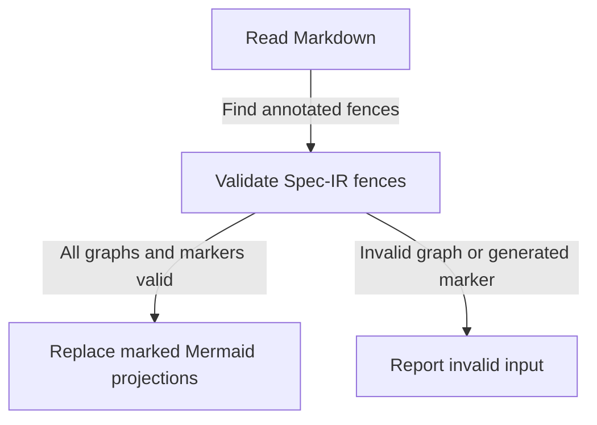

# Spec-IR renderer

[Authoring guide](../spec-ir.md)

```yaml spec-ir
id: spec-ir-render
kind: flow
nodes:
  - {id: input, type: input, label: Read Markdown, meta: {encoding: UTF-8}}
  - {id: validate, type: operation, label: Validate Spec-IR fences, meta: {graph_kinds: [flow, state, api, data], constraints: Reject duplicate IDs and keys, reference_rule: Edge endpoints must name nodes in their graph}}
  - {id: render, type: output, label: Replace marked Mermaid projections, meta: {preserve: Unmarked text and line endings, repeat_runs: Byte-identical result}}
  - {id: error, type: output, label: Report invalid input, meta: {result: Nonzero exit without writing the document}}
edges:
  - {from: input, to: validate, label: Find annotated fences, meta: {}}
  - {from: validate, to: render, label: All graphs and markers valid, meta: {}}
  - {from: validate, to: error, label: Invalid graph or generated marker, meta: {}}
```
<!-- spec-ir:start -->

<!-- spec-ir:end -->
