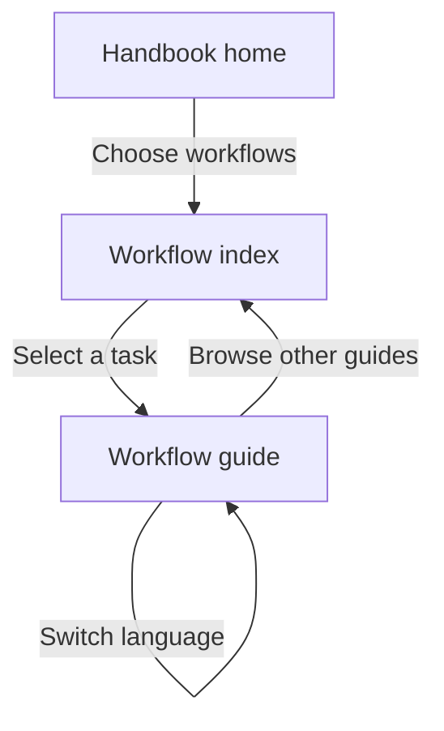

# Practical workflows

```yaml spec-ir
id: workflow-navigation
kind: flow
nodes:
  - {id: home, type: page, label: Handbook home, meta: {default: English, access: Both language indexes}}
  - {id: index, type: page, label: Workflow index, meta: {path: "workflows/<language>.md", coverage: Every guide in the selected language}}
  - id: guide
    type: page
    label: Workflow guide
    meta:
      path: "workflows/<task-slug>/<language>.md"
      languages: [en, es]
      audience: Readers without a programming background
      include: [Goal, Prerequisites, Numbered steps, Worked example, Observable success check, Recovery if the check fails]
      platform_specific: Identify the client and link the provider documentation for setup or feature claims
edges:
  - {from: home, to: index, label: Choose workflows, meta: {}}
  - {from: index, to: guide, label: Select a task, meta: {target: Same language}}
  - {from: guide, to: guide, label: Switch language, meta: {target: Sibling edition of the same task}}
  - {from: guide, to: index, label: Browse other guides, meta: {target: Same language}}
```
<!-- spec-ir:start -->

<!-- spec-ir:end -->
